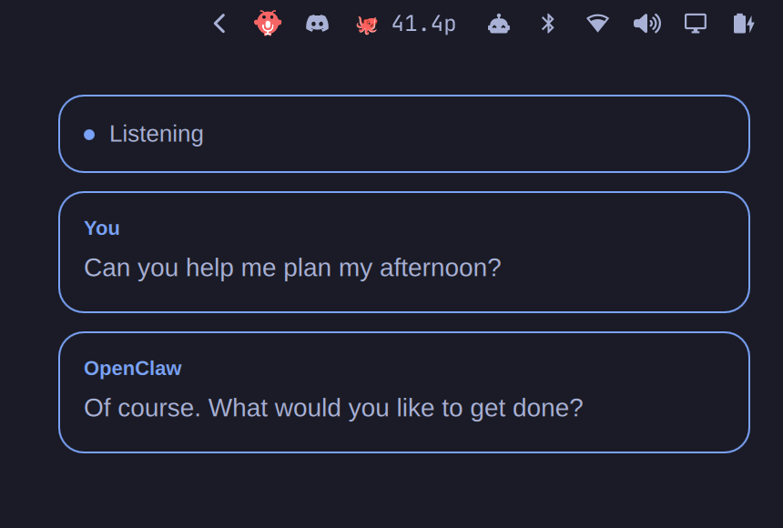

# Omarchy OpenClaw Voice

**v0.6.1 - voice lifecycle and privacy fixes.** This full release hardens audio
and test-tone shutdown, preserves continuing hold replies and keeps private
configuration values out of errors and audio-worker environment inheritance.
It includes the expandable answer reader, audio-device selection with a local
test tone, and keyboard/touch hold controls with configurable release behaviour.
It retains opt-in wake activation, verified readiness, independent speech/input
controls, honest action observations and explicit agent/target presets.
Companion setup and optional wake models remain manual. See [the changelog](CHANGELOG.md)
and [compatibility and limits](docs/COMPATIBILITY.md).
The marketplace lists this plugin with manual companion setup.

Talk to your OpenClaw agent through a **native Omarchy bar control and speech bubbles**.
Click the **OpenClaw lobster-and-microphone icon** to
start; repeat to stop. A green dot marks an active call; amber marks an error.
Voice status and themed speech bubbles stay together at the top right, showing
your words and OpenClaw's reply as they arrive. The bottom orb is hidden by
default. The conversation display does not take keyboard focus or block clicks
on your work. Long replies show a bounded excerpt; ending a call clears the live bubbles.

The interface is adapted from **[OMA by wombatoperator and contributors](https://github.com/wombatoperator/omarchy-voice)**,
with its original MIT notice preserved. See [CREDITS.md](CREDITS.md) for the exact
source revision and changed files. This is early, independent software.

## Screenshots

The top-right status card and both sides of the conversation:



The lobster-and-microphone bar control, close up:


These are captures of the actual widgets with sample conversation text and a
plain background. The microphone stayed off. See [capture details](docs/images/README.md).

## How it works

The native Quickshell plugin displays state from a small local service. During
an explicit call, a native **GStreamer** worker handles microphone capture,
echo cancellation, speaker audio and WebRTC through Omarchy's PipeWire audio
server. The launcher uses a private Unix socket. No browser or local HTTP server
is required. See [the architecture decision](docs/ARCHITECTURE.md).

The bridge connects to your existing local or remote OpenClaw gateway. It requests
`gpt-live-1-codex` with `brain: agent-consult` so your selected agent supplies
tools, memory and reasoning through OpenClaw. Voice controls and approvals
remain owned by the gateway. Clicking the icon never approves a pending action.
The app has no fixed agent name. Set `sessionKey` in your private configuration
to select your own OpenClaw agent and conversation.

### Agent support

This version connects to OpenClaw. It uses OpenClaw's Gateway SDK, Talk session
API, agent consultation, authentication and ordinary tool approval routing.
`sessionKey` selects an agent within OpenClaw; it does not connect directly to
Codex CLI, Claude Code or another agent service.

The Quickshell interface and GStreamer audio components could be reused for
another backend, with their MIT attribution preserved. That would need an
adapter for the other backend's session, audio, cancellation and permission
contracts. No such adapter is included here. Speech currently uses GPT-Live
through the OpenClaw gateway's ChatGPT OAuth setup.

Speech uses the gateway's existing **ChatGPT OAuth** setup. No API key or paid
speech fallback is added. Before each call, the bridge checks the gateway's
visible configuration for an OAuth profile and rejects configured OpenAI API
keys. It cannot inspect hidden server environment variables or guarantee a
future gateway configuration. Keep the gateway's speech provider OAuth-only.
Existing agent reasoning fallbacks are preserved; a fallback can still incur
its own provider's charges even though speech uses OAuth.

The gateway's native PCM relay was evaluated but failed during startup on the
initial deployment. This version uses the working gateway-controlled WebRTC
path. It does not patch the gateway or replace its authentication.

## Requirements

- Omarchy with its Lua Hyprland configuration and Quickshell plugin system.
- Node.js 22+, Python 3 with PyGObject, GStreamer, and a user systemd session.
- GStreamer base/good/bad plugins and libnice, including `webrtcbin`,
  `webrtcdsp`, Opus and PulseAudio elements. `native/audio.py --check` checks them.
- An OpenClaw installation exposing `dist/plugin-sdk/gateway-runtime.js`, plus
  its runtime dependencies and the realtime Talk WebRTC API. The latest manual
  trial used an OpenClaw main build labelled `2026.10.3`, containing the merged
  voice/text permission and Talk consultation lifetime fixes. A released minimum
  version is not yet established; a main-build label is not a stock-release test.
  See [tested compatibility](docs/COMPATIBILITY.md) before installation.
- A local or remote gateway configured in `~/.openclaw/openclaw.json`, gateway
  authentication with the needed operator scopes, and working GPT-Live ChatGPT OAuth.

Existing OpenClaw credentials remain in OpenClaw's own private store. Do not
copy gateway tokens, OAuth credentials or personal configuration into this repo.

## Local and remote OpenClaw

A VPS is optional. With OpenClaw and this app on the same Omarchy machine,
`gateway.mode: "local"` selects `ws://127.0.0.1:18789` (or `gateway.port`). The app
reads the existing `gateway.auth.token` or `gateway.auth.password` for the initial
connection; OpenClaw still handles device authentication and permissions. An
explicit local mode ignores any stale remote address in the configuration.

With `gateway.mode: "remote"`, the app uses `gateway.remote.url` and that remote's
credentials or existing paired-device authentication. Older configurations with
a remote URL but no mode remain supported. A missing remote URL is an error;
the app does not silently switch agents by falling back to a local gateway.

Plain `ws://` is accepted only for `127.0.0.1`, `localhost` and `[::1]`. Other
hosts require `wss://`. Voice-session offers use HTTP on loopback and HTTPS for
secure gateways. Local OpenClaw can keep its normal loopback binding; no LAN
exposure, VPS or reverse proxy is needed. Local TLS uses `gateway.tls.enabled`
and requires a certificate trusted by Node for both WebSocket and HTTPS.

ChatGPT OAuth must be configured on whichever gateway runs your agent. Running
OpenClaw locally does **not** make GPT-Live an offline model. The same OAuth-only
voice checks and OpenClaw approval rules apply to both locations.

The app reads JSON configuration. `OPENCLAW_CONFIG_PATH`, `OPENCLAW_STATE_DIR`,
`OPENCLAW_HOME` and a local `OPENCLAW_GATEWAY_PORT` are supported when supplied to
the voice service. Local authentication can also use `OPENCLAW_GATEWAY_TOKEN` or
`OPENCLAW_GATEWAY_PASSWORD`. These local credentials are never reused for a remote
gateway. Literal secrets, `${ENV_VAR}` and environment SecretRefs are supported;
file/exec SecretRefs are rejected. A systemd service does not inherit variables
exported only in an interactive terminal. Keep any environment file private.

See [the local validation notes](docs/LOCAL-GATEWAY.md) for tested behavior and
the remaining full-conversation check.

## Install

This is one plugin, `community.openclaw-voice`, plus an explicitly installed
companion. Adding/enabling the plugin only loads its bar control and visual
children. It does not install dependencies, start a service, enroll a device or
open the microphone. Plugins run inside Omarchy's unsandboxed user shell.

The plugin can be installed directly from the repository:

```sh
omarchy plugin add https://github.com/brokemac79/omarchy-openclaw-voice
omarchy plugin enable community.openclaw-voice
```

Marketplace verification applies
to an exact commit; the ordinary add/update commands follow repository HEAD.
Review the chosen commit before setup. The root manifest includes the complete
UI; no sibling plugin folders are needed.

Install the companion separately from that same reviewed checkout, inside your
Linux graphical session. First install missing dependencies through Omarchy,
using `omarchy pkg add python-gobject gst-plugins-base gst-plugins-good
gst-plugins-bad libnice`. The Python script never installs packages.

```sh
cd "$HOME/.config/omarchy/plugins/community.openclaw-voice"
python3 install.py                       # preview every planned file change
python3 install.py --apply               # install companion, leave it stopped
# If Node is outside PATH, add --node /path/to/node to both commands.
```

Configure OpenClaw and the voice options below before explicitly starting the
companion with `systemctl --user start openclaw-voice.service`. This connects to
the configured Gateway and may require ordinary device approval. Check
`openclaw-voice status` and `openclaw-voice preflight`; neither starts capture.
Clicking the bar icon or invoking the app launcher explicitly starts a call.
The service is not enabled at login. Installing/upgrading stops an existing
default companion and leaves it stopped; no automatic reconnect or enrollment
happens during setup.

**Shortcut replacement is optional.** To replace an existing Super+Shift+V
binding, review `python3 install.py --replace-shortcut`, then repeat with
`--apply`. Reload Hyprland manually with `hyprctl reload` after reviewing the
installed include. Without this flag, the installer leaves Hyprland unchanged,
including a shortcut opted into during an earlier installation.

Backups and an ownership receipt live under
`$XDG_STATE_HOME/openclaw-voice/` (default `~/.local/state/openclaw-voice/`).
Existing files from legacy setup or later user edits cause a refusal. Review a
preview with `--replace-existing` before consenting to replace them; originals
are retained for removal. Symlink destinations are rejected before changes.
XDG directories outside HOME are supported. Packaged Omarchy is never edited.

For upgrades, stop voice, review the plugin update, update its checkout through
Omarchy, then preview/apply the companion installer again. A plugin update alone
does not update the separately copied service. **v0.3.4 two-plugin installations
need the explicit migration in [removal and migration](docs/REMOVAL.md).**

Default dependency locations match an OpenClaw Node installation under
`~/.local/share/openclaw-node/node_modules/`. To override them, create
`~/.config/openclaw-voice/config.json` with mode `0600`:

```json
{
  "gatewaySdk": "/path/to/openclaw/dist/plugin-sdk/gateway-runtime.js",
  "python": "/usr/bin/python3",
  "sessionKey": "agent:main:main",
  "voice": "cove"
}
```

`openclawConfig`, `inputDevice` and `outputDevice` are optional. The latter two
are stable PulseAudio device names from `pactl list short sources` and
`pactl list short sinks`. The defaults use the system microphone and speakers.
**Audio setup** in the bar's voice controls provides device selection
without editing JSON, plus an explicit two-second local test tone. Saved private
preferences take precedence over those configuration defaults. Read-only JSON
discovery requires `pactl`. See [audio setup and test limits](docs/AUDIO-DEVICES.md).
**Hold to talk** provides touch and focused Space-key input, with an
optional configured global shortcut. `holdRelease` selects input mute with reply
continuation (default) or End voice on release. Capture remains open while input
is muted. See [hold controls and timing limits](docs/HOLD-TO-TALK.md).
If upgrading, replace any old browser device IDs with these native names. This integration
does not discover or control Sonos or Spotify devices.

For separate test instances, SDK binding and safe connection diagnostics, see
[separate voice instances](docs/INSTANCES.md). The updated client uses ordinary
UI pairing. Review enrollment before upgrading an existing service.

## Controls and limits

On the main branch, startup shows Connecting or Preparing voice until microphone frames, native
transport and Talk readiness are all confirmed. The compact Ready cue then
indicates when to speak. Component-specific failures show a recovery action;
reconnecting the Gateway never starts audio. See [startup readiness and timing
boundaries](docs/STARTUP-READINESS.md).

| Control | Action |
| --- | --- |
| Bar icon / app launcher / opted-in Super+Shift+V | Start or end the conversation |
| `openclaw-voice stop` | End voice and release microphone/playback |
| `openclaw-voice mute` | Toggle microphone transmission during a call |
| `openclaw-voice quiet` / `resume-speech` | Silence / resume local speech without changing microphone input or host work |
| `openclaw-voice end-voice` | End the call; submitted host work may continue |
| `openclaw-voice cancel-request` | Report unavailable until an exact request cancellation contract exists |
| `openclaw-voice status` | Show local connection and microphone state |
| `openclaw-voice preflight` | Check visible gateway authentication and voice readiness |
| `openclaw-voice diagnostics` | Show bounded startup/first-reply timings and sanitized failure codes without starting audio |
| `openclaw-voice standby-conversation` | Explicitly arm an independently configured local wake detector; Talk stays open after activation |

Right-click the bar icon for separate **Mute input**, **Quiet** and **End voice**
controls. **Cancel request** is visibly unavailable for the current native route.
The controls show work status as unknown and retain the last received final text
excerpt after End or audio failure; dismiss it or start a new call to clear it.
See [interruption controls and the upstream cancellation gap](docs/INTERRUPTIONS.md).

On main, **Open answer** in those controls opens a scrollable, selectable reader
for received replies, with copy actions, text sizing and explicit web links.
It retains bounded partial/final text after End or audio failure without adding
transcript history. See [answer reader limits and controls](docs/ANSWERS.md).

Action observations show Heard or Outcome unknown separately from spoken captions.
Authoritative execution results are still pending an upstream correlation contract;
see [action progress and remaining work](docs/ACTION-PROGRESS.md).

Hover the compact bar icon for the selected agent and node/conversation context;
an optional compact agent label is available in the widget settings. Right-click
for explicit destination presets; End voice and review/dismiss unknown outcomes
before switching. Configure exact existing destinations privately; see
[agent and target selection](docs/DESTINATIONS.md).

Microphone mute sends silence while keeping the input device open; Stop releases the device and closes
the audio engine. A network or engine failure stops the conversation. Reconnection
does not reopen the microphone. WebRTC supports speaking over a reply; physical
microphone, speaker and echo behaviour still require a test on each device.
Version 0.5.0 includes optional local wake activation, disabled by default, with support for both "Hey OpenClaw"
and "Hey Open Claw" through the separately provisioned sherpa-onnx model. Say the
phrase, wait for Talk readiness, then speak. Stop disarms input; automatic return
to standby is deferred. See [setup, validation and limits](docs/WAKE-WORD.md).

OpenClaw requires a fresh confirmation for voice actions it classifies as
high-impact, including computer/node control such as opening an app. Answer the
specific request with a spoken **yes** or **no** while the same call is active.
The gateway binds confirmation to that action; the app does not bypass it or
approve by clicking the widget. See [OpenClaw's Talk confirmation rules](https://docs.openclaw.ai/nodes/talk/realtime-sessions).
Spoken confirmation support is documented upstream; test the full exchange with
your gateway version before relying on it.

The current user/reply excerpt, short status and two audio levels are stored with private permissions
under `$XDG_RUNTIME_DIR/openclaw-voice/`. The bridge does not save audio or transcript
history. OpenClaw and the voice provider have their own session storage.

Playback uses a 200 ms network jitter buffer and Opus packet-loss concealment.
These reduce sensitivity to late or missing packets; they cannot repair a poor
connection. If speech is distorted, check that the system or per-app volume is
not boosted above 100% before changing audio routing.

For problems, first run `openclaw-voice status`, then check the user service status
and gateway Talk diagnostics privately. Do not post raw diagnostics containing
tokens, transcripts or private hostnames.

For removal or rollback, follow [the removal procedure](docs/REMOVAL.md).
The backup manifest records overwritten files and their original modes.
Do not restore an old full shell configuration over later customizations.

## Development and licence

See [CONTRIBUTING.md](CONTRIBUTING.md), [SECURITY.md](SECURITY.md) and
[CREDITS.md](CREDITS.md). MIT, with upstream notices retained in [LICENSE-OMA](LICENSE-OMA).

The root bar widget owns its conversation/status surfaces. The companion is
installed separately and keeps working when the UI is disabled; stop voice
before hiding or removing the plugin. Re-enabling the UI does not start audio.
See [release preparation](docs/RELEASING.md) for the remaining sharing requirements.
